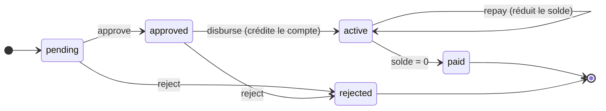

# CAPOSA — Module Prêts : contrat backend/frontend

*Version du 26 octobre 2026*

Ce document décrit comment fonctionne un prêt dans CAPOSA, du point de vue du backend (Django REST, développé par CS) et du frontend (Next.js). Il fait foi en cas de doute entre les deux équipes.

## Principe

Le backend est la seule source de vérité financière ; le frontend affiche et collecte, il ne calcule rien.

| Le backend décide | Le frontend fait |
| --- | --- |
| Statuts et transitions d'un prêt | Afficher le statut, proposer les boutons permis |
| Montants : intérêts, échéances, solde restant | Afficher les montants reçus, sans les recalculer |
| Retard et niveau de risque | Afficher un badge selon `is_late` / `late_days` |
| Validations métier (montant, durée, compte, limites) | Valider le format du formulaire, afficher les erreurs du backend |
| Mouvements d'argent (transactions) | Déclencher l'action, afficher le reçu |

Pourquoi : si le front recalcule un montant, l'écran et la base finissent par diverger. Un membre ne doit jamais voir un solde différent de celui enregistré.

## Cycle de vie

Un prêt passe par cinq statuts ; seuls `active` et `paid` impliquent de l'argent réel.



| Statut | Libellé |
| --- | --- |
| `pending` | En attente |
| `approved` | Approuvé |
| `active` | Décaissé |
| `paid` | Remboursé |
| `rejected` | Rejeté |

Une demande peut être rejetée tant qu'elle n'est pas décaissée. Une fois `active`, le prêt ne peut que se rembourser jusqu'à `paid`.

## Mouvement d'argent

Un prêt ne bouge de l'argent qu'à deux moments : le décaissement et le remboursement. Chacun crée une `Transaction` reliée au prêt par une clé `loan`.

**Décaissement** — la coopérative remet l'argent au membre.

- Le montant est **crédité sur le compte du membre** (transaction `LOAN_DISBURSEMENT`).
- Aucune session caisse n'est nécessaire. Si le membre veut du cash, il fait ensuite un retrait normal.
- C'est à ce moment que démarrent les échéances et que la date de fin est fixée.

**Remboursement** — le membre rembourse la coopérative. Géré par le module prêts, jamais par un dépôt.

- `cash` (cas principal) : le membre paie au guichet, l'argent entre dans la caisse. Une session caisse ouverte est obligatoire.
- `account` : le montant est débité du compte du membre, s'il a le solde.
- Transaction `LOAN_REPAYMENT`. Montant refusé s'il dépasse le solde restant.
- Quand le solde restant atteint 0, le prêt passe automatiquement à `paid`.

Pourquoi pas un dépôt : un dépôt augmente l'épargne du membre. L'argent qui rembourse un prêt n'appartient plus au membre ; le compter comme un dépôt fausserait la comptabilité et le solde du prêt.

## Modèle Loan

Les noms ci-dessous sont ceux du modèle Django réel ; le frontend les utilise tels quels.

**Saisis à la création (modifiables seulement tant que le prêt est `pending`)**

| Champ | Sens |
| --- | --- |
| `member` | Le membre emprunteur |
| `account` | Compte existant du membre, crédité au décaissement |
| `loan_type` | `commerce`, `agriculture`, `elevage`, `logement`, `equipement`, `scolaire`, `personnel` |
| `loan_amount` | Capital prêté, en HTG |
| `interest_rate` | Taux d'intérêt en % (annuel ou mensuel : voir questions ouvertes) |
| `loan_duration` | Durée en mois |
| `payment_frequency` | `weekly` (hebdomadaire), `biweekly` (toutes les deux semaines), `monthly` |
| `guarantor_account` | Compte d'un garant, facultatif |
| `notes` | Objet du prêt et remarques |

**Fixés par le backend, jamais envoyés par le front**

| Champ | Fixé quand |
| --- | --- |
| `status` | À chaque transition (voir cycle de vie) |
| `employee` | À la création : l'employé connecté |
| `request_date` | À la création |
| `approval_date` | À l'approbation |
| `disbursement_date` | Au décaissement |
| `due_date` | Au décaissement : `disbursement_date` + `loan_duration` mois |
| `closed_at` | Quand le prêt passe à `paid` |
| `rejection_reason` | Au rejet : raison obligatoire, envoyée par `reject` |

**Calculés, en lecture seule** : `total_due`, `installment_amount`, `amount_paid`, `remaining_balance`, `next_due_date`, `is_late`, `late_days` (détail plus bas).

Attention au libellé : `biweekly` signifie toutes les deux semaines (« bihebdomadaire »), pas deux fois par mois (« bimensuel »).

## Endpoints

Un statut ne change jamais par un `PATCH` : chaque transition a son action dédiée, avec ses propres contrôles.

| Méthode et chemin | Rôle | Qui |
| --- | --- | --- |
| `GET /loans/` | Liste, filtres `?member=` et `?status=` | Tout employé connecté |
| `GET /loans/{id}/` | Détail d'un prêt | Tout employé connecté |
| `POST /loans/` | Créer une demande (statut `pending`) | Conseiller, superviseur, directeur |
| `PATCH /loans/{id}/` | Corriger une demande, seulement si `pending` | Conseiller, superviseur |
| `POST /loans/{id}/approve/` | `pending` → `approved` | Superviseur, directeur, admin |
| `POST /loans/{id}/reject/` | `pending` ou `approved` → `rejected` | Superviseur, directeur, admin |
| `POST /loans/{id}/disburse/` | `approved` → `active`, crédite le compte | Caissier, superviseur |
| `POST /loans/{id}/repay/` | Enregistre un remboursement | Caissier |
| `GET /loans/{id}/payments/` | Remboursements de ce prêt | Tout employé connecté |
| `DELETE /loans/{id}/` | Supprimer, seulement si `pending` ou `rejected` | Directeur |

Corps de `repay` :

```json
{ "amount": 2500.00, "method": "cash", "session": "<uuid de la session caisse>" }
```

Réponse de `repay` : la transaction créée, le `remaining_balance` mis à jour et le `status` du prêt.

## Règles métier

Toutes ces règles sont vérifiées par le backend ; le front peut les rappeler dans le formulaire, mais ne les applique pas seul.

1. Montant strictement supérieur à 0.
2. Durée entre 3 et 60 mois.
3. Taux d'intérêt supérieur ou égal à 0.
4. Le compte `account` appartient au membre emprunteur.
5. Le compte garant n'est pas le compte de l'emprunteur, ni un autre compte du même membre.
6. Un membre a au plus **un prêt non clos** à la fois (`pending`, `approved` ou `active`). Sinon il pourrait empiler des demandes.
7. Montant, taux et durée sont **verrouillés après approbation**. Pour changer les conditions, on rejette et on refait une demande.
8. Un remboursement ne dépasse jamais le solde restant.
9. Un remboursement en cash exige une session caisse ouverte.
10. Un prêt décaissé ou remboursé ne peut être ni rejeté ni supprimé.

La création d'une demande ne demande **ni caisse ni session** : c'est un travail de conseiller, pas une opération de guichet.

## Calculs et retard

CAPOSA utilise l'**intérêt simple** : le taux s'applique au capital initial pendant toute la durée. Tous les arrondis se font au backend, à 2 décimales (HTG).

Avec un taux annuel :

```
total_due = loan_amount × (1 + interest_rate / 100 × loan_duration / 12)
```

| Champ | Signification |
| --- | --- |
| `total_due` | Capital + intérêts, ce que le membre doit au total |
| `installment_amount` | Montant d'une échéance : `total_due` divisé par le nombre d'échéances selon la fréquence |
| `amount_paid` | Somme des remboursements de ce prêt |
| `remaining_balance` | `total_due` − `amount_paid` ; n'existe qu'après le décaissement |
| `next_due_date` | Date de la prochaine échéance non payée |
| `is_late`, `late_days` | Retard compté depuis la **prochaine échéance non payée**, pas depuis la date de fin |

Niveau de risque, affiché par le front d'après `late_days` :

| Retard | Classe |
| --- | --- |
| 0 jour | À jour |
| 1 à 29 jours | En retard |
| 30 jours et plus | Critique |

Un prêt `pending` ou `approved` ne doit rien encore : pas de solde, pas de retard.

## Phase 2 et questions ouvertes

**Phase 2** — après que décaissement et remboursement fonctionnent, car ils en dépendent :

- `GET /loans/kpis/` : nombre de prêts, montants décaissés, encours, remboursé, taux d'approbation, taux de paiement à temps.
- `GET /loans/analytics/` : volumes dans le temps, répartition par type et par statut, progression des remboursements. Toujours avec les vrais types et statuts du modèle.

**Questions ouvertes**

- [ ] `interest_rate` est-il annuel ou mensuel ? Le document suppose annuel.
- [ ] Faut-il un taux par défaut par type de prêt ?
- [ ] Faut-il des frais de dossier ou des pénalités de retard ?